<!-- The hero is a plain image: the report lives behind a workspace sign-in, so
     there is nothing public to link it to. The <h1> is real text, not pixels in
     the SVG, so the project name is something a search engine and a screen
     reader both get. -->
<h1>Fleet Pulse — Trucking Operations on Databricks</h1>
<picture>
  <source media="(prefers-color-scheme: dark)" srcset="assets/hero-dark.svg">
  
</picture>

<p>
  
  
  
  
  
  
  
</p>

A medallion lakehouse over three years of trucking operations (~85K trips,
14 source tables, 2022–2024). It answers questions a star schema alone cannot:
**where the revenue actually goes**, **which drivers and trucks carry it**, and
**what the fleet's maintenance bill buys** — all answerable in natural language
through a Genie agent that reads governed metric views instead of raw tables.

| | | |
|---|---|---|
| 🛢️ | **[Part 1 · The pipeline](#part-1--the-pipeline)** | Bronze → silver → gold on Lakeflow Declarative Pipelines: streaming tables where the data streams, materialized views where it aggregates. **Yearly batches, not a 1,096-day replay.** |
| ⚡ | **[Part 2 · Optimizations](#part-2--optimizations)** | Eight pipeline choices with measured reasons — clustering, write sizing, quality gates, and one error that proved two clauses cannot coexist. |
| 🧭 | **[Part 3 · The semantic layer](#part-3--the-semantic-layer)** | Four metric views that own the KPI definitions — and the finding that the dataset's own aggregates disagree with its facts by **13.8% on revenue**. |
| 💬 | **[Part 4 · The Genie agent](#part-4--the-genie-agent)** | Natural language over governed measures, held to account by benchmarks with checked ground truth. Includes the join-grain trap that halved a metric's revenue. |
| 📊 | **[Part 5 · The dashboard](#part-5--the-dashboard)** | KPIs, trends, rankings — with the agent embedded as an Ask Genie button. |
| ▶️ | **[Part 6 · Run it yourself](#part-6--run-it-yourself)** | Regenerate the data, deploy the bundle, recreate the views, open the report. |

---

## 🎯 Why this project is worth a look

<picture>
  <source media="(prefers-color-scheme: dark)" srcset="assets/why-dark.svg">
  
</picture>

<br>

**Part 3** is where it gets interesting. The dataset ships pre-aggregated driver
and truck monthly metrics that look like a shortcut — point the semantic layer at
them and skip the joins. They disagree with the trip facts by **13.8% on revenue**
and **34% on on-time rate**, and none of their `AVG()` columns can be re-aggregated
without the weight denominators, which aren't in the table. All four metric views
read `silver.trip_events` instead. Every total in this README was computed, not
copied from anywhere.

---

<!-- The live report cannot be shared: Free Edition dashboards require the
     viewer to sign in to this workspace, and widgets render from a warehouse
     neither a fork nor a reader has. Part 5 rebuilds it end to end instead —
     the committed dashboard JSON is the same artifact the workspace runs. -->
The dashboard itself has no public URL: it runs inside this workspace behind
sign-in, and a dashboard link shared with another Free Edition account shows
them nothing. The honest substitute is [Part 6 — Run it yourself](#part-6--run-it-yourself):
the committed `dashboards/fleet_pulse_dashboard.json` recreates it on any
workspace, and every figure below is a checked query, not a screenshot.

---

## 🔌 How it is wired

<picture>
  <source media="(prefers-color-scheme: dark)" srcset="assets/architecture-dark.svg">
  
</picture>

30 yearly CSVs (12.5 MB of fact files) land in a Unity Catalog volume, Auto
Loader builds **14 bronze streaming tables**, silver joins them into one trip
fact, and gold materializes **5 tables**. Four **metric views** then own the KPI
definitions and serve both the Genie agent and the dashboard — one semantic
layer, two consumers.

---

<a id="part-1--the-pipeline"></a>

## Part 1 — The pipeline


The original plan replayed the dataset day by day — 1,096 files, one per day, fed
into Auto Loader to simulate live telemetry. An hour in, about a third of the days had
landed and two earlier runs had already died, so I stopped it. The fix was to stop pretending: **one CSV per year per table**,
so the three yearly files arrive as three natural Auto Loader batches, and the
pipeline shows real streaming behaviour without a day-paced background job.

| | Layer | Choice | Why |
|---|---|---|---|
| 🟦 | **Bronze · facts** | 8 **streaming tables**, Auto Loader | Facts keep arriving, so they stream — exactly-once via file-path dedup, no hand-set checkpoints (Lakeflow manages those). |
| 🟦 | **Bronze · dimensions** | 6 **streaming tables**, `pathGlobFilter` | `read_files()` needs a *directory*, and all six files share one folder — the filter picks each table's file. |
| 🟪 | **Silver** | 1 **streaming table** | One star-schema join at trip grain, partitioned into the three years, with expectations dropping rows before they pollute gold. |
| 🟩 | **Gold · aggregations** | 3 **materialized views** | A streaming table is append-only — a `GROUP BY` in one appends a new partial group per batch instead of recomputing. Aggregations must be MVs. |
| 🟩 | **Gold · enrichment** | 2 **streaming tables** | Plain dimension joins with no aggregate; those stay streaming and refresh incrementally. |

### Verified row counts

Every table was queried after the final run — these are the live workspace's numbers.

| Table | Rows | | Table | Rows |
|---|---|---|---|---|
| `bronze.loads` / `trips` | 85,410 / 85,410 | | `silver.trip_events` | 85,410 |
| `bronze.delivery_events` | 170,743 | | `gold.on_time_delivery` | 77,202 |
| `bronze.fuel_purchases` | 196,241 | | `gold.route_profitability` | 2,088 |
| `bronze.maintenance_records` | 2,920 | | `gold.fuel_efficiency_trend` | 2,088 |
| `bronze.safety_incidents` | 170 | | `gold.fleet_utilization` | 3,312 |
| `bronze.driver_monthly_metrics` | 4,464 | | `gold.driver_scorecard` | 4,464 |
| `bronze.truck_utilization_metrics` | 3,312 | | | |

---

<a id="part-2--optimizations"></a>

## Part 2 — Optimizations


### What was tuned, and why

| | Optimization | Why |
|---|---|---|
| 🔷 | **Liquid clustering** on 8 fact + 1 silver tables, keyed to each table's filter column (`load_date`, `dispatch_date`, `route_id`, `driver_id`, `truck_id`) | Auto Loader lands files in arrival order, not date order. Without clustering, each of the 3 yearly batches fragments the layout, and every date filter degrades toward a full scan. |
| 📦 | **`optimizeWrite`** on silver + gold only | Coalesces the small-file tail that 3 discrete batches leave behind. Skipped on bronze deliberately — Auto Loader output is already file-ordered, so it adds write cost with no layout gain. |
| 🗂️ | **Year isolation in the cluster key, not `PARTITIONED BY`** | The two clauses are mutually exclusive in Lakeflow (`SPECIFY_CLUSTER_BY_WITH_PARTITIONED_BY_IS_NOT_ALLOWED`). 3 years is far too coarse to partition on anyway, and cluster keys can evolve without a table rewrite. |
| 🚨 | **Expectations on silver** | `load_date IS NOT NULL`, `revenue >= 0`, `customer_id IS NOT NULL` — dropped before they can reach a join or a gold aggregate. |
| 🏷️ | **`schemaHints` + rescue column on every bronze table** | Types pinned across the 3 yearly files so batches cannot drift; malformed rows land in `_rescued_data` instead of failing the batch. |
| 🔀 | **Streaming tables where data streams, materialized views where data aggregates** | Streaming tables are append-only — a `GROUP BY` in one appends a new partial group per batch instead of recomputing. Bronze facts and silver stream; the three gold aggregations are MVs. |
| ☁️ | **Serverless pipeline** | No cluster warm-up; cost accrues only while runs execute. |
| ♾️ | **Zero checkpoint paths** | Lakeflow manages Auto Loader checkpoints internally. A hand-set `checkpointLocation` is a raw `writeStream` concept — it does not belong in Lakeflow SQL. |

---

<a id="part-3--the-semantic-layer"></a>

## Part 3 — The semantic layer


Four metric views, each with **exactly one source** (the one-fact-source rule).
Ratios always compose as `MEASURE(a) / MEASURE(b)` over atomic sums:

| Metric view | Source | Owns |
|---|---|---|
| `trip_metrics` | `silver.trip_events` | on-time rate, revenue/mile, MPG — by customer, route, month |
| `driver_metrics` | `silver.trip_events` + `drivers` | trips, revenue, MPG, on time, idle — by driver |
| `truck_metrics` | `silver.trip_events` + `trucks` | trips, revenue, MPG, idle — by truck |
| `truck_maintenance_metrics` | `bronze.maintenance_records` + `trucks` | events, cost, downtime — a separate fact, kept apart on purpose |

> [!CAUTION]
> **An average of an average is not an average.** Computing MPG as
> `AVG(average_mpg)` across trips gives 6.5015 when the true value is
> `SUM(miles) / SUM(gallons)` = **6.4477**. The same error hides in on-time rate:
> dividing by all 85,410 trips instead of the 85,333 that actually recorded a
> delivery event. Every golden ratio in this project divides summed numerators,
> not averaged ones.

### The finding: the dataset disagrees with itself

| Metric | Trip facts | Source's own monthly tables | Δ |
|---|---|---|---|
| Total revenue | $298.6M | $257.3M | **−13.8%** |
| Total trips | 85,410 | 83,696 / 83,738 | −1,714 |
| On-time rate | 33.3% | 44.6% | **+34% relative** |
| MPG | 6.4477 | 6.5015 | +0.8% |

`driver_monthly_metrics` and `truck_utilization_metrics` are generated
independently of `loads`/`trips`/`delivery_events` — two unrelated truths in one
file set. The 1,714-trip gap has a cause: those trips carry an **empty
`driver_id`**. They surface as `'Unassigned'` rather than being dropped, so
revenue still ties out, and the ranking example filters them.

> [!WARNING]
> **Numeric results are only half the correctness story.** The pre-aggregated
> tables are cheap to scan — 2K–77K rows against 85K — which makes them
> *tempting*. Cheap and wrong is still wrong. The tables that look like helpers
> are the trap.

---

<a id="part-4--the-genie-agent"></a>

## Part 4 — The Genie agent


Every metric view declares its own joins (`dim_driver`, `dim_truck`), and Genie
reads them from the view's table properties — so the space needs **no
`join_specs`** and **no `column_configs`** (per-column metadata lives in the view
YAML, not duplicated in the space).

| Surface | Count |
|---|---|
| Data sources (metric views) | 4 |
| Sample questions | 5 |
| Example SQLs (`MEASURE()` patterns) | 6 |
| Text instructions | 1 block — purpose, disambiguation, data-quality notes, constraints |
| Benchmarks | 7 — six with checked SQL, one Agent-mode with a grading note |
| `join_specs` / `column_configs` | 0 / 0 — by design |

### The join-grain trap

Genie's first attempt at *"which trucks cost the most in maintenance relative to
what they earn"* joined the two views on `Truck ID + Month` — reasonable-looking
and wrong:

| Join grain | Revenue retained | Top ratio |
|---|---|---|
| `Truck ID + Month` | $143.4M of $298.6M | 0.046 |
| `Truck ID` only | $292.7M | **0.0235** |

`truck_metrics.Month` is the **dispatch** month; `truck_maintenance_metrics.Month`
is the **service** month. They rarely coincide, so the month-grain join silently
dropped half the revenue and doubled every ratio.

> [!TIP]
> **A `join_spec` cannot express "don't join on this column."** The fix was a
> grain rule in CONSTRAINTS plus an example SQL that aggregates each view to the
> entity first. Free-text rules alone were ignored; the example SQL stuck.
> Retested after the fix: Genie emits the truck-level join and returns 0.0235.

---

<a id="part-5--the-dashboard"></a>

## Part 5 — The dashboard


One canvas page, 12 widgets, Okabe-Ito palette (colour-blind safe), light and
dark theme pairs. Datasets read the **metric views** with bare table names,
resolved by `--dataset-catalog fleet_pulse --dataset-schema gold`.

| | Widget | The question |
|---|---|---|
| 💰 | **Revenue KPI** | How much did the fleet earn? $298.6M |
| 🚚 | **Trips KPI** | How many trips delivered it? 85,410 |
| ⏱️ | **On-time KPI** | What share arrived on schedule? 33.3% |
| ⛽ | **MPG KPI** | How efficiently? 6.45 mpg |
| 📈 | **Revenue trend** (line) | Is the business growing month over month — or is it seasonal? |
| ⛽ | **MPG trend** (line) | Does efficiency drift with fleet age — the maintenance-vs-economy question? |
| 🛤️ | **Routes bar** | Which lanes earn the most per mile? Top 10, RTE00015 leading at $3.62 |
| 😤 | **Customers bar** | Which accounts wait the longest? Weakest 10 by on-time rate |
| 🧑‍✈️ | **Driver table** | 15 drivers by revenue, with MPG and on-time side by side |
| 🔧 | **Truck table** | 15 trucks by downtime, with service events and cost |

> [!NOTE]
> **The dashboard reads the semantic layer, not the tables.** Six datasets, six
> `SELECT ... FROM trip_metrics GROUP BY ALL` queries — so a click on a bar
> filters only that dataset, and the Authenticity guarantee is that the dashboard
> and a hand-written query can never disagree.

<details>
<summary><b>Capture these three screenshots for docs/</b> (the browser requires SSO, so they aren't in the repo)</summary>

1. The dashboard, published, from Dashboards in the workspace sidebar
2. A Genie conversation showing the generated `MEASURE()` SQL
3. The Lakeflow pipeline graph from the Jobs & Pipelines UI

```markdown


```
</details>

---

<a id="part-6--run-it-yourself"></a>

## Part 6 — Run it yourself


```bash
git clone https://github.com/methunt/databricks-fleet-lakehouse-genie.git
cd databricks-fleet-lakehouse-genie
python loader/build_annual_csvs.py    # 30 CSVs, byte-identical on re-run
```

| ☑️ **Prerequisites** |
|---|
| Databricks CLI ≥ 1.3.0 · a Unity Catalog workspace with serverless compute · `kagglehub` |

**1 — Catalog and volume.**

```bash
databricks experimental aitools tools query "CREATE CATALOG IF NOT EXISTS fleet_pulse"
# …bronze / silver / gold schemas, then:
databricks experimental aitools tools query "CREATE VOLUME IF NOT EXISTS fleet_pulse.bronze.raw_events"
```

**2 — Upload.** Every directory needs `dbfs:` — without it the CLI writes a path
Spark cannot see.

```bash
for d in dimensions loads trips delivery_events fuel_purchases \
         maintenance_records safety_incidents driver_monthly_metrics \
         truck_utilization_metrics; do
  databricks fs mkdirs "dbfs:/Volumes/fleet_pulse/bronze/raw_events/$d"
done
databricks fs cp --overwrite annual_csvs/customers.csv \
  dbfs:/Volumes/fleet_pulse/bronze/raw_events/dimensions/customers.csv   # …all 30
```

**3 — Pipeline.**

```bash
databricks bundle deploy -t dev --profile <profile>
databricks bundle run    fleet_pulse_etl -t dev --profile <profile>
```

**4 — Metric views.** Via the Statement Execution API, not
`experimental aitools tools query` — that flattens the YAML indentation inside
`$$…$$` and the server rejects the definition.

```bash
for f in src/fleet_pulse_etl/metric_views/*.sql; do
  jq -Rs --arg wh "$WAREHOUSE_ID" '{warehouse_id:$wh, statement:., wait_timeout:"30s"}' "$f" > /tmp/p.json
  databricks api post /api/2.0/sql/statements/ --json @/tmp/p.json --profile <profile>
done
```

**5 — Genie and dashboard.** The dashboard JSON links the agent by space ID, so create the space first and
put its ID into the dashboard before creating it.

```bash
SPACE_ID=$(databricks genie create-space --json "$(jq -c . genie/fleet_pulse_genie.json)" \
  --profile <profile> -o json | jq -r .space_id)
sed "s/<GENIE_SPACE_ID>/$SPACE_ID/" dashboards/fleet_pulse_dashboard.json > /tmp/dashboard.json
databricks lakeview create \
  --display-name "Fleet Pulse — Trucking Operations" \
  --warehouse-id "$WAREHOUSE_ID" \
  --dataset-catalog fleet_pulse --dataset-schema gold \
  --serialized-dashboard "$(cat /tmp/dashboard.json)" \
  --json '{"parent_path": "/Workspace/Users/<you>/dashboards"}' --profile <profile>
databricks lakeview publish <DASHBOARD_ID> --warehouse-id "$WAREHOUSE_ID" --profile <profile>
```

---

## 📚 Reference

### ⚠️ Things that will bite you

| | |
|---|---|
| **`dbfs:` prefix** | `databricks fs cp` to a UC Volume without it writes a path Spark cannot see. Every destination needs the prefix. |
| **`read_files()` takes a directory** | Pointing it at a `.csv` file fails at planning. Six dimensions share one folder, so each bronze table narrows with `pathGlobFilter`. |
| **`DATE_TRUNC` returns TIMESTAMP** | Declaring a `DATE` month column from it fails schema merge. Every gold month column is `CAST(DATE_TRUNC(...) AS DATE)`. |
| **Streaming table ≠ aggregation** | `CREATE STREAMING TABLE ... AS SELECT ... GROUP BY` parses and then misbehaves: append-only semantics append partial groups. Aggregations must be materialized views. |
| **Case-sensitive string filters** | Silver joined `event_type = 'delivery'` while the data said `'Delivery'` — every row failed, and `gold.on_time_delivery` sat at 0 rows despite the update reporting `COMPLETED`. |
| **Bundle deploy needs `schema`** | UC pipelines reject deployment without a target `schema` field in the pipeline resource. |
| **Metric views deploy via API** | `aitools tools query` flattens YAML indentation inside `$$…$$`; the server answers `METRIC_VIEW_INVALID_VIEW_DEFINITION`. `databricks api post /api/2.0/sql/statements/` sends the body verbatim. |
| **Dashboard updates re-pass the flags** | `lakeview update` replaces the serialized dashboard; omitting `--dataset-catalog`/`--dataset-schema` nulls the bare-table resolution and breaks every query. Then `publish` again — draft and published are separate snapshots. |
| **1,714 trips have no driver** | An empty `driver_id` in the source. Surfaced as `'Unassigned'` rather than dropped, so revenue ties out. |
| **Two gold tables still disagree** | `driver_scorecard` and `fleet_utilization` still read the unreconciled source aggregates. Nothing consumes them; they are candidates for deletion or re-pointing. |

### 📁 Repo layout

```
├── databricks.yml                      # DAB root — catalog, warehouse, dev target
├── resources/
│   └── fleet_pulse_etl.pipeline.yml    # Lakeflow pipeline resource
├── src/fleet_pulse_etl/
│   ├── transformations/                # pipeline SQL: bronze → silver → gold
│   └── metric_views/                   # 4 governed metric views (YAML in SQL)
├── genie/fleet_pulse_genie.json        # serialized_space: sources, examples, benchmarks
├── dashboards/
│   └── fleet_pulse_dashboard.json      # the deployed AI/BI dashboard
├── loader/build_annual_csvs.py         # regenerates the 30 CSVs (verified byte-identical)
├── scripts/                            # build_assets.py — the SVGs above, from one spec
└── assets/                             # generated SVGs, light + dark
```

`annual_csvs/` is git-ignored (58 MB). Regenerate with `python loader/build_annual_csvs.py`.

### 🧪 The data

Kaggle [`yogape/logistics-operations-database`](https://www.kaggle.com/datasets/yogape/logistics-operations-database)
— 14 tables, 2022–2024. ~85K trips, ~57K delivery events per year, 120 trucks,
150 drivers, 58 routes. A few hundred 2025-01-01 spillover rows from trips
crossing the year boundary are dropped by both the pipeline and the loader.

### 📄 Licence

[MIT](LICENSE). No production data, no personal data — the dataset is synthetic
Kaggle content.
