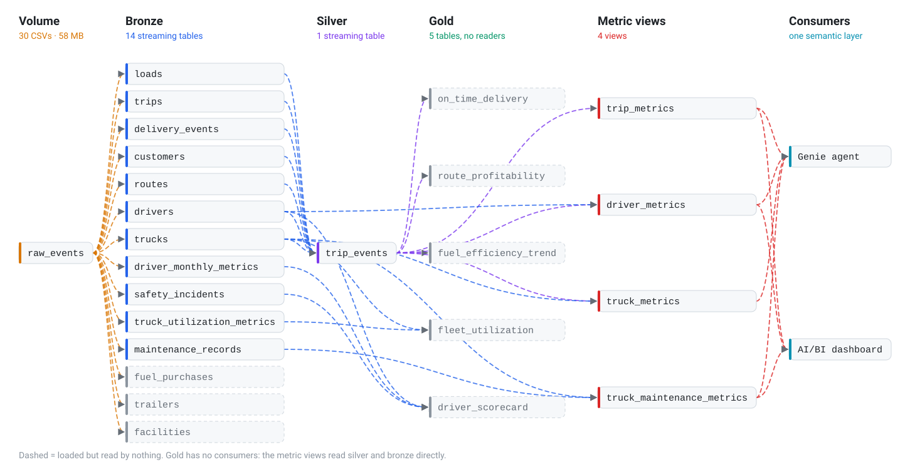
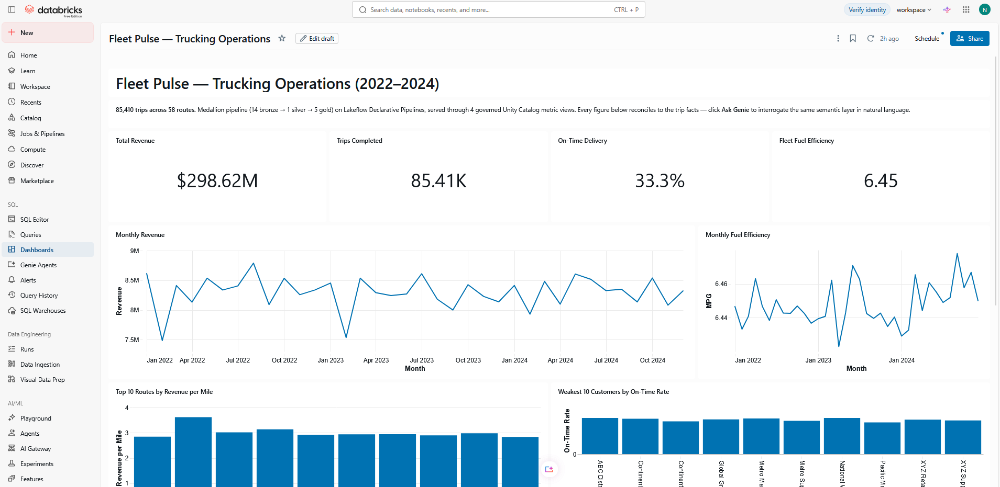

<!-- The <h1> is real text, not pixels in the hero SVG, so the project name is
     something a search engine and a screen reader both get. -->
<h1>Fleet Pulse — AI-driven data engineering, human as architect</h1>
<picture>
  <source media="(prefers-color-scheme: dark)" srcset="assets/hero-dark.svg">
  
</picture>

  
  
  
  
  

**I did not write this pipeline. I specified it, and an AI agent built it end to end** —
the Lakeflow SQL, four metric views, a Genie agent, an AI/BI dashboard and the
acceptance checks. My job was the part an agent cannot own: the architecture, the
rules each layer must obey, and the definition of "correct".

The workload is a real-shaped one: three years of trucking operations (~85K trips,
14 tables, 2022–2024) on Databricks. What this repo shows is the division of labour behind it.

| | | |
|---|---|---|
| 🧑‍💼 | **[Step 1 · The operating model](#step-1--the-operating-model)** | Who decides, who builds, who verifies — and why the human keeps the outcome. |
| 🧱 | **[Step 2 · Layer rules](#step-2--layer-rules)** | What logic each layer may and may not carry. The architecture is mine; the agent implements inside it. |
| 🎯 | **[Step 3 · The spec](#step-3--the-spec)** | The numbers the result must hit, written first and run as live checks. |
| 🔍 | **[Step 4 · Where the human mattered](#step-4--where-the-human-mattered)** | Four moments a plausible result was wrong, and what caught it. |
| 🤖 | **[Step 5 · What the agent built](#step-5--what-the-agent-built)** | Pipeline, metric views, Genie agent, dashboard and checks. |
| ♻️ | **[Step 6 · Use it as a template](#step-6--use-it-as-a-template)** | Four steps to run your own agent-built pipeline. |

> [!NOTE]
> The technical write-up — row counts, optimizations, the dataset finding, run
> instructions — is in **[DETAILS.md](DETAILS.md)**.

---

## 🎯 Why this approach

<picture>
  <source media="(prefers-color-scheme: dark)" srcset="assets/approach-dark.svg">
  
</picture>

 

An agent is fast and literal. It will produce SQL that runs, returns rows, reports
`COMPLETED` — and is wrong. So the human work is writing down what "right" means
before the agent starts, and checking the result against it afterwards.

---

## Step 1 — The operating model

| | Role | Human (me) | Agent |
|---|---|---|---|
| 🧭 | **Decides** | What gets built, in which layer, under which rules | — |
| 🛠️ | **Builds** | — | SQL, YAML, JSON, Python, bundle config |
| 📏 | **Defines "correct"** | The numbers and invariants the output must match | — |
| ✅ | **Verifies** | Reviews results against the spec; stops work that is going wrong | Runs queries and checks, reports counts |
| 🏁 | **Owns the outcome** | Yes | No |

> [!IMPORTANT]
> The rules the agent works from are written down in [`AGENTS.md`](AGENTS.md):
> layer boundaries, traps that already cost time, and the verified numbers.

---

## Step 2 — Layer rules

Each layer has one job. I set the boundaries; the agent wrote the code within them.

| | Layer | Allowed to | Not allowed to |
|---|---|---|---|
| 🟦 | **Bronze** | Land source files as-is with Auto Loader; pin types; keep malformed rows in `_rescued_data` | Clean, join or filter business data |
| 🟪 | **Silver** | One star-schema join at trip grain; drop rows that break basic expectations | Aggregate |
| 🟩 | **Gold** | Aggregate, as **materialized views** | Aggregate in a streaming table — a `GROUP BY` there appends partial groups |
| 🧭 | **Metric views** | Own every KPI. Ratios are `MEASURE(a) / MEASURE(b)` over summed values | Average an average; read the source's pre-aggregated monthly tables |
| 💬 | **Genie agent** | Answer from the metric views only | Join views on a grain that changes what a metric means |
| 📊 | **Dashboard** | Read the metric views, so it and a hand-written query cannot disagree | Carry its own KPI logic |

---

## Step 3 — The spec

Target numbers live in `AGENTS.md` and are executed by
[`tests/test_acceptance.py`](tests/test_acceptance.py) against the live workspace.

| | Check | Expected |
|---|---|---|
| 💰 | **Revenue / trips** | $298,621,429 / 85,410 |
| ⏱️ | **On-time rate** | 33.27%, over 85,333 logged deliveries — not all trips |
| ⛽ | **Fleet MPG** | 6.4477 (Σ miles ÷ Σ gallons, not 6.5015 from averaging) |
| 🧑‍✈️ | **Trips with no driver** | 1,714, kept as `Unassigned`, not dropped |
| 🗄️ | **Row counts** | bronze 85,410 · delivery events 170,743 · gold on-time 77,202 |
| 🔗 | **Truck join grain** | `Truck ID` only keeps ~$292.7M; adding `Month` loses half |
| 🕳️ | **Gold not empty** | A pipeline once reported `COMPLETED` with 0 rows in a gold table |

> [!TIP]
> The agent wrote the checks. The expected values are mine, and the agent does not
> get to change them.

---

## Step 4 — Where the human mattered

| | Moment | What happened | What it shows |
|---|---|---|---|
| ⏹️ | **The replay** | The first design replayed data day by day: 1,096 files. An hour in, a third had landed and two runs had died. I stopped it and moved to one CSV per year per table. | Judging a design not worth finishing is a human call. |
| 0️⃣ | **`COMPLETED` with 0 rows** | An update succeeded while `gold.on_time_delivery` held 0 rows: a compare on `'delivery'` where the data said `'Delivery'`. | Status is not correctness. Count rows after every refresh. |
| 🪤 | **The pre-aggregated tables** | The dataset's monthly tables look like a shortcut and disagree with the trip facts by 13.8% on revenue. Every metric view reads the trip fact instead. | Cheap and wrong is still wrong. |
| 🔀 | **The join-grain trap** | Genie joined two views on `Truck ID + Month` and silently dropped half the revenue. A written rule was ignored; an example query fixed it. | Prose rules fail where worked examples hold. |

> [!CAUTION]
> **Plausible is the failure mode.** Every row above returned results and looked
> reasonable. Full numbers and fixes are in [DETAILS.md](DETAILS.md).

---

## Step 5 — What the agent built

| | Deliverable | Contents |
|---|---|---|
| 🛢️ | **Pipeline** | 14 bronze streaming tables, 1 silver trip fact, 5 gold tables, on Lakeflow Declarative Pipelines |
| 🧭 | **Semantic layer** | 4 governed metric views |
| 💬 | **Genie agent** | 4 sources, 5 sample questions, 6 example SQLs, 7 benchmarks |
| 📊 | **AI/BI dashboard** | 12 widgets over the metric views, with Ask Genie embedded |
| 🧪 | **Acceptance checks** | 7 live checks in `tests/test_acceptance.py` |
| 📦 | **Deployment** | Databricks Asset Bundle, one `dev` target |

<a href="assets/lineage-light.svg">
<picture>
  <source media="(prefers-color-scheme: dark)" srcset="assets/lineage-dark.svg">
  
</picture>
</a>

Click the graph to open it full size and zoom.

The dashboard runs in a Free Edition workspace behind sign-in, so it has no public
link. [DETAILS.md](DETAILS.md#part-6--run-it-yourself) rebuilds it from the committed JSON.

---

## Step 6 — Use it as a template

| | Step | Do |
|---|---|---|
| 1️⃣ | **Write the architecture** | Layer boundaries and rules, before any code. Put them in `AGENTS.md`. |
| 2️⃣ | **Write the numbers** | The values the result must hit, from queries you trust. |
| 3️⃣ | **Let the agent build** | And have it write checks that execute your numbers. |
| 4️⃣ | **Read results against the spec** | Stop work that is going wrong. Count rows after every refresh. |

---

[Technical details](DETAILS.md) · [Agent instructions](AGENTS.md) · [MIT licence](LICENSE)
